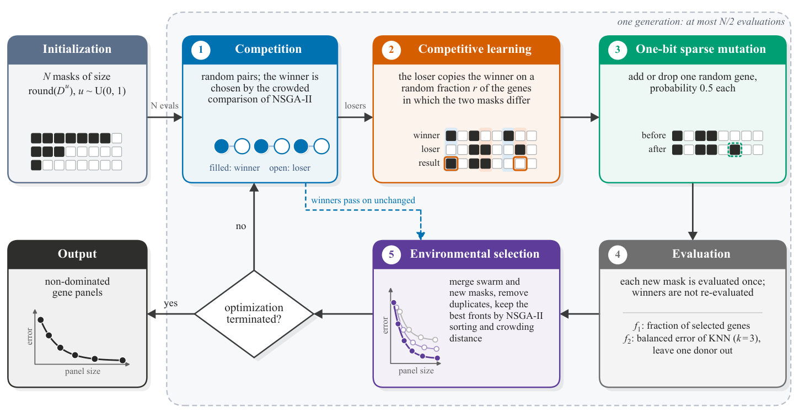

<h1 align="center">SBMOCSO</h1>

<p align="center">
  <b>A Sparse Binary Multi-Objective Competitive Swarm Optimizer for Evaluation-Efficient Gene Selection in Ophthalmic Transcriptomic Data</b>
</p>

<p align="center">
  
  
  
</p>

This repository contains the official implementation of **SBMOCSO**, the eight compared multi-objective algorithms, the six ophthalmic gene expression datasets, and the scripts that reproduce every table and figure of the paper.

---

## Overview

Selecting a small gene panel that separates disease states is a bi-objective problem: minimize the fraction of selected genes and minimize the classification error, with thousands of candidate genes and only a few dozen samples. SBMOCSO solves it with a competitive swarm that works directly on binary gene masks.

<p align="center">
  
</p>

**Key ideas**

- **Competitive learning on the disagreement set.** Particles compete in random pairs. The loser copies its winner on a random fraction of the genes in which the two masks differ, so sparse parents give a sparse offspring without any threshold.
- **Log-uniform initialization.** Initial panel sizes are drawn as `round(D^u)` with `u ~ U(0, 1)`, which spreads the swarm evenly over orders of magnitude of panel size, from a single gene to the full gene set.
- **One-bit sparse mutation.** Each new mask gains or loses one random gene with probability 0.5 each, so every gene stays reachable.
- **No scoring stage and no tunable parameter.** Winners are not re-evaluated, the search starts with the first evaluations, and the only setting is the swarm size.

## Repository structure

```
SBMOCSO/
├── sbmocso/                  # library
│   ├── core.py               #   population container and budgeted evaluation
│   ├── operators.py          #   non-dominated sorting, crowding distance, variation operators
│   ├── problem.py            #   bi-objective gene selection problem
│   ├── metrics.py            #   non-dominated filtering and 2-D hypervolume
│   └── algorithms/           #   SBMOCSO and the eight compared algorithms
├── scripts/
│   ├── prepare_data.py       #   rebuild data/processed from the GEO files
│   ├── run_one.py            #   one algorithm x one dataset x one split x one budget
│   ├── run_all.py            #   all 8100 runs of the paper
│   ├── analysis.py           #   statistical tests and tables
│   ├── figures.py            #   result figures
│   ├── gene_check.py         #   Open Targets check of the selected genes
│   └── gene_literature.py    #   OpenAlex literature search
├── data/
│   ├── processed/            #   the six datasets (2000 most variable genes each)
│   └── gene_check/           #   Open Targets (release 26.09) and OpenAlex snapshots
└── assets/                   #   images for this README
```

## Installation

```bash
git clone https://github.com/Qipeng-hub/SBMOCSO.git
cd SBMOCSO
pip install -r requirements.txt     # numpy, scipy, matplotlib
```

No GPU and no compiled extension are needed.

## Quick start

Run SBMOCSO once on the macular retina AMD dataset (split 0, 10,000 evaluations):

```bash
python scripts/run_one.py SBMOCSO AMD-RET-GSE29801 0 10000
```

The result is written to `results/main/SBMOCSO/AMD-RET-GSE29801/r0.npz` and contains the final population, its training objectives, the test errors, the training and test hypervolumes, and the convergence curve.

Use SBMOCSO from Python:

```python
from sbmocso.algorithms import sbmocso
from sbmocso.core import MOTask
from sbmocso.problem import GeneSelection

problem = GeneSelection("UM-GSE22138", run=0)       # dataset name and split index
task = MOTask(problem, N=100, max_fes=10000, seed=1)
result = sbmocso.run(task)
print(result.objs)                                  # (fraction of genes, balanced KNN error) of the final swarm
```

Any problem object with the attributes `M`, `D`, `lower`, `upper`, `encoding` and the methods `cal_obj(dec)` and `cal_con(dec)` can be passed to `MOTask`, so SBMOCSO can be applied to other sparse binary problems.

### Available algorithms

| Name | Type | Name | Type |
|---|---|---|---|
| `NSGA-II` | classic multi-objective EA | `AFSEA` | sparse multi-objective EA |
| `SparseEA` | sparse multi-objective EA | `LMOCSO` | competitive swarm optimizer |
| `PM-MOEA` | sparse multi-objective EA | `S-ECSO` | competitive swarm optimizer |
| `MSKEA` | sparse multi-objective EA | **`SBMOCSO`** | **proposed** |
| `SparseEA2` | sparse multi-objective EA | | |

All algorithms use a population of 100 and the default parameters of [PlatEMO](https://github.com/BIMK/PlatEMO).

### Ablation variants

Variants of SBMOCSO are selected with `key=value` options:

```bash
python scripts/run_one.py SBMOCSO TED-GSE58331 0 10000 init=uniform    # uniform size initialization
python scripts/run_one.py SBMOCSO TED-GSE58331 0 10000 full_copy=true  # full copy of the winner
python scripts/run_one.py SBMOCSO TED-GSE58331 0 10000 mutate=false    # without one-bit sparse mutation
```

## Datasets

The processed datasets are included in `data/processed`. Each keeps the 2000 genes with the largest variance; samples of the same donor or subject are kept on the same side of every train/test split.

| Name | GEO series | Platform | Task | Samples (case/control) | Donors |
|---|---|---|---|---|---|
| AMD-RPE | GSE29801 | Agilent (GPL4133) | AMD vs. normal, macular RPE–choroid | 91 (41/50) | 91 |
| AMD-RET | GSE29801 | Agilent (GPL4133) | AMD vs. normal, macular retina | 58 (31/27) | 58 |
| UM-1 | GSE22138 | Affymetrix (GPL570) | Metastasis vs. none, primary uveal melanoma | 63 (35/28) | 63 |
| UM-2 | GSE44295 | Illumina (GPL6883) | Metastasis vs. none, primary uveal melanoma | 57 (24/33) | 57 |
| TED | GSE58331 | Affymetrix (GPL570) | Thyroid eye disease vs. normal, anterior orbit | 49 (27/22) | 43 |
| DR | GSE160306 | RNA-seq (GPL20301) | NPDR/PDR vs. no DR, macula and periphery | 76 (36/40) | 43 |

To rebuild them from the original GEO files, place the files listed in `scripts/prepare_data.py` in `data/raw` and run:

```bash
python scripts/prepare_data.py
```

## Reproducing the paper

```bash
# 1. All runs: main comparison (10,000 evaluations), budgets (2000, 5000, 20,000), ablation
python scripts/run_all.py --workers 32

# 2. Statistical tests, tables, and figures
python scripts/analysis.py          # -> output/tables, output/summary.json
python scripts/figures.py           # -> output/figures

# 3. Check of the selected genes (Table S2 and Figure 10)
python scripts/gene_check.py counts --gene-info Homo_sapiens.gene_info.gz
python scripts/gene_check.py test
python scripts/gene_check.py figure
```

The 8100 runs take about 7 CPU hours in total, about 15 minutes on 32 cores. `python scripts/run_all.py --list` prints the command line of every run so that the runs can be distributed over a cluster, and `--group main|budget|ablation` runs one group only. The train/test split of every run and the random seed of every algorithm are fixed in the code, so the results are reproducible.

`Homo_sapiens.gene_info.gz` is the NCBI gene annotation file, available from the [NCBI FTP site](https://ftp.ncbi.nlm.nih.gov/gene/DATA/GENE_INFO/Mammalia/).

## Citation

If you use this code or the processed datasets, please cite the paper:

```
A Sparse Binary Multi-Objective Competitive Swarm Optimizer for Evaluation-Efficient Gene Selection
in Ophthalmic Transcriptomic Data.
```

The full reference will be added here after publication.

## Acknowledgements

The expression data come from the [Gene Expression Omnibus](https://www.ncbi.nlm.nih.gov/geo/). The gene check uses the [Open Targets Platform](https://platform.opentargets.org/) and [OpenAlex](https://openalex.org/). The parameter settings of the compared algorithms follow [PlatEMO](https://github.com/BIMK/PlatEMO).

## Contact

Questions and bug reports are welcome through [GitHub Issues](https://github.com/Qipeng-hub/SBMOCSO/issues).
